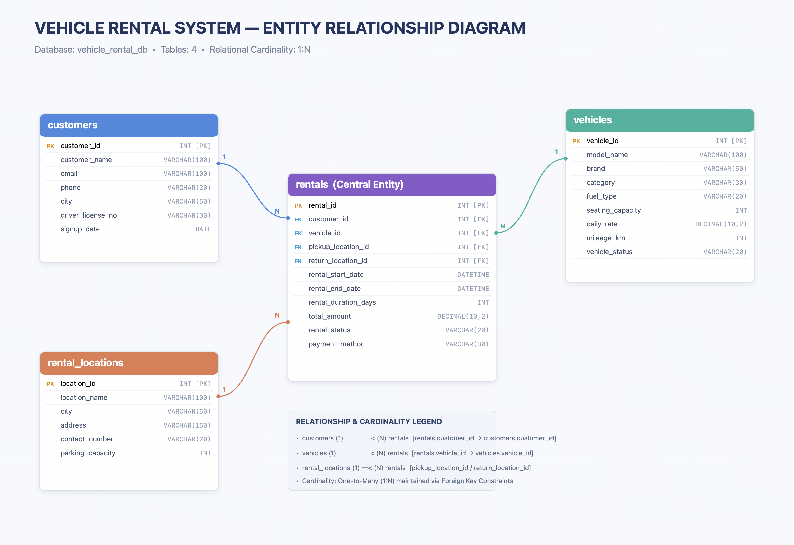

# 🚗 Vehicle Rental System — MySQL SQL Project

A comprehensive, production-grade MySQL relational database project for managing customers, fleet vehicles, pickup/drop-off rental locations, and vehicle rental transactions.

This project demonstrates practical SQL engineering skills including relational database architecture, primary & foreign keys, integrity constraints, multi-table JOINs, grouped aggregations, nested & correlated subqueries, Common Table Expressions (CTEs), and advanced window analytical functions.

---

## 🚀 Project Highlights

- **Database:** `vehicle_rental_db`
- **Tables:** 4 (`customers`, `vehicles`, `rental_locations`, `rentals`)
- **Total Dataset Records:** 30,600 verified rows
- **SQL Queries:** 60 queries (20 Simple, 20 Medium, 20 Hard)
- **Difficulty Progression:** Simple ➔ Medium ➔ Hard
- **Tools & Environments:** MySQL 8.0+, MySQL Workbench, MySQL CLI, Git, GitHub

---

## 📌 Project Overview

The **Vehicle Rental System** models the complete operational workflow of a modern car and vehicle rental enterprise.

The database organizes four primary entities:

- 👤 **Customers** — Stores customer profiles, contact info, driving license numbers, and registration dates.
- 🚘 **Vehicles** — Stores fleet inventory details including brand, model, vehicle category (SUV, Sedan, Hatchback, Luxury, Electric, Compact SUV), fuel type, seating capacity, daily rental rate, odometer mileage, and operational status.
- 🏢 **Rental Locations** — Stores airport hubs, downtown branches, railway/metro stations, and parking capacities across major cities.
- 📋 **Rentals** — The central transactional entity connecting customers, vehicles, pickup locations, and return locations. It records start/end timestamps, duration, calculated total amounts, rental statuses (`Completed`, `Active`, `Cancelled`, `Reserved`), and payment methods.

---

## 🎯 Project Objectives

- Design a normalized relational schema for commercial fleet rental management.
- Establish foreign-key relationships ensuring strict referential integrity.
- Populate a realistic, high-volume synthetic dataset (30,600 records) simulating real-world operations.
- Execute basic SQL data querying, filtering, pattern matching, and sorting.
- Perform multi-table relational analysis using `INNER JOIN` and `LEFT JOIN`.
- Aggregate business KPIs using `GROUP BY`, `HAVING`, and statistical functions (`SUM`, `AVG`, `MAX`, `MIN`).
- Build nested subqueries, correlated subqueries, and multi-tier CTEs.
- Implement window ranking functions (`ROW_NUMBER()`, `DENSE_RANK()`, `PARTITION BY`) for business intelligence.
- Analyze fleet utilization, revenue streams, city performance, customer lifetime value, and payment preferences.

---

## 🗄️ Database Structure

**Database Name:** `vehicle_rental_db`

The database contains four interconnected tables:

| Table | Description | Records | Primary Key |
|---|---|---:|---|
| `customers` | Customer personal and driving license records | 10,000 | `customer_id` |
| `vehicles` | Fleet inventory, specifications, and daily rates | 500 | `vehicle_id` |
| `rental_locations` | Pickup and return stations, addresses, and capacities | 100 | `location_id` |
| `rentals` | Rental bookings and transactional history | 20,000 | `rental_id` |
| **Total** | | **30,600** | |

---

### 1. `customers` Table

| Column | Data Type | Constraint | Description |
|---|---|---|---|
| `customer_id` | `INT` | PRIMARY KEY | Unique customer identifier |
| `customer_name` | `VARCHAR(100)` | NOT NULL | Customer full name |
| `email` | `VARCHAR(100)` | NULL | Customer email address |
| `phone` | `VARCHAR(20)` | NULL | Customer contact phone number |
| `city` | `VARCHAR(50)` | NULL | Customer residence city |
| `driver_license_no` | `VARCHAR(30)` | NULL | Government driving license number |
| `signup_date` | `DATE` | NULL | Customer account registration date |

---

### 2. `vehicles` Table

| Column | Data Type | Constraint | Description |
|---|---|---|---|
| `vehicle_id` | `INT` | PRIMARY KEY | Unique vehicle fleet identifier |
| `model_name` | `VARCHAR(100)` | NOT NULL | Vehicle model name (e.g. Fortuner, Creta, Model 3) |
| `brand` | `VARCHAR(50)` | NOT NULL | Automobile manufacturer (e.g. Toyota, BMW, Hyundai) |
| `category` | `VARCHAR(30)` | NOT NULL | Vehicle class (SUV, Sedan, Luxury, Electric, etc.) |
| `fuel_type` | `VARCHAR(20)` | NOT NULL | Fuel type (Petrol, Diesel, Electric, Hybrid) |
| `seating_capacity` | `INT` | NOT NULL | Number of passenger seats (4, 5, 7) |
| `daily_rate` | `DECIMAL(10,2)` | NOT NULL | Base rental price per day |
| `mileage_km` | `INT` | NULL | Odometer mileage in kilometers |
| `vehicle_status` | `VARCHAR(20)` | DEFAULT 'Available' | Availability (`Available`, `Rented`, `Maintenance`) |

---

### 3. `rental_locations` Table

| Column | Data Type | Constraint | Description |
|---|---|---|---|
| `location_id` | `INT` | PRIMARY KEY | Unique branch/hub identifier |
| `location_name` | `VARCHAR(100)` | NOT NULL | Station name (e.g. Airport Terminal Hub #1) |
| `city` | `VARCHAR(50)` | NOT NULL | Station city |
| `address` | `VARCHAR(150)` | NULL | Street address and location landmark |
| `contact_number` | `VARCHAR(20)` | NULL | Branch desk telephone |
| `parking_capacity` | `INT` | NULL | Total vehicle bay capacity |

---

### 4. `rentals` Table

| Column | Data Type | Constraint | Description |
|---|---|---|---|
| `rental_id` | `INT` | PRIMARY KEY | Unique rental transaction identifier |
| `customer_id` | `INT` | FOREIGN KEY | References `customers(customer_id)` |
| `vehicle_id` | `INT` | FOREIGN KEY | References `vehicles(vehicle_id)` |
| `pickup_location_id` | `INT` | FOREIGN KEY | References `rental_locations(location_id)` |
| `return_location_id` | `INT` | FOREIGN KEY | References `rental_locations(location_id)` |
| `rental_start_date` | `DATETIME` | NOT NULL | Date and time vehicle picked up |
| `rental_end_date` | `DATETIME` | NOT NULL | Date and time vehicle scheduled/returned |
| `rental_duration_days`| `INT` | NOT NULL | Total rental duration in days |
| `total_amount` | `DECIMAL(10,2)` | NOT NULL | Final rental bill amount |
| `rental_status` | `VARCHAR(20)` | NOT NULL | Status (`Completed`, `Active`, `Cancelled`, `Reserved`) |
| `payment_method` | `VARCHAR(30)` | NOT NULL | Method (`UPI`, `Credit Card`, `Debit Card`, `Net Banking`, `Cash`) |

---

## 🔗 ER Diagram & Database Relationships

<p align="center">
  
</p>

### Cardinality Breakdown:

```
customers (1) ──────────┐
                        │
vehicles (1) ───────────┼───< rentals (N)
                        │
rental_locations (1) ───┘  [pickup_location_id & return_location_id]
```

- **`customers` ➔ `rentals` (1 : N):** One customer can complete multiple vehicle rentals over time.
- **`vehicles` ➔ `rentals` (1 : N):** One vehicle can be rented repeatedly across different date periods.
- **`rental_locations` ➔ `rentals` (1 : N):** Each rental originates from one pickup location and concludes at one return location (supporting one-way drop-offs).

---

## 🎥 Project Demo & Screen Recording

A full video walkthrough showcasing the project architecture, database schema, relational queries, and execution is included in this directory:

<video src="Screen%20Recording%202026-10-22%20235519.mp4" controls width="100%"></video>

> 📥 **Direct Video File:** [`Screen Recording 2026-10-22 235519.mp4`](Screen%20Recording%202026-10-22%20235519.mp4)

---

## 📊 SQL Analysis — 60 Practice Queries

The project includes **60 meticulously designed queries** categorized across three difficulty tiers:

### 🟢 Simple Queries (Q1 – Q20) — `Simple_queries.txt`
Basic data retrieval, filtering, pattern matching, sorting, and aggregate summary functions:
- `SELECT`, `WHERE`, `LIKE`, `IN`, `ORDER BY`, `LIMIT`, `DISTINCT`
- Aggregate functions: `COUNT()`, `SUM()`, `AVG()`, `MIN()`, `MAX()`
- Date filtering (`signup_date >= '2025-01-01'`)
- Status filtering (`rental_status = 'Completed'`)

### 🟡 Medium Queries (Q1 – Q20) — `Medium_queries.txt`
Relational joins, multi-table linking, grouped analysis, and condition logic:
- `INNER JOIN` across 2, 3, and all 4 tables
- `LEFT JOIN` for identifying unrented fleet units
- `GROUP BY` and `HAVING` filters
- `CASE` expressions for customer spend and rental tier categorization
- Subqueries for nested ID lookups
- Date extraction (`YEAR()`, `MONTH()`)

### 🔴 Hard Queries (Q1 – Q20) — `Hard_queries.txt`
Advanced business intelligence and complex analytical SQL:
- Common Table Expressions (`WITH ... AS (...)`)
- Window ranking functions: `ROW_NUMBER()`, `DENSE_RANK()`, `RANK()`
- Group-partitioned analysis using `PARTITION BY`
- Top-N analysis per category, brand, and city
- Market-share / Revenue percentage contribution calculations
- Identifying repeat high-frequency customers

---

## 💼 Key Business Questions Explored

The queries answer key business operations and executive questions:

- Which vehicle models and manufacturers generate the highest gross revenue?
- Who are the top 5% most valuable customers by lifetime rental spend?
- Which pickup locations and metropolitan hubs experience the highest rental demand?
- What is the revenue contribution percentage of each vehicle class (SUV vs Sedan vs Luxury vs Electric)?
- Which vehicles in the fleet have never been rented and may represent idle assets?
- What are the most preferred payment channels across completed bookings?
- How does rental frequency vary across calendar months and years?

---

## 📁 Repository Structure

```text
Vehicle rental system/
│
├── README.md                           # Complete documentation and setup manual
├── Screen Recording 2026-10-22 235519.mp4 # Full HD project walkthrough & demo video
├── vehicle_rental.sql                  # Full database dump (DDL, constraints & 30,600 rows)
├── vehicle_rental.db                   # Pre-loaded SQLite database for zero-setup execution
├── run_project.py                      # Interactive Python query runner
├── ER-Diagram.png                      # High-resolution Entity Relationship Diagram
├── Database_Restore_Guide.txt          # Step-by-step restoration instructions
├── Execution.txt                       # Execution guide & recommended query sequence
├── Simple_queries.txt                  # 20 Beginner SQL practice queries
├── Medium_queries.txt                  # 20 Intermediate relational SQL queries
└── Hard_queries.txt                    # 20 Advanced SQL queries (CTEs, Window Functions)
```

---

## 🚀 How to Run the Project

### Prerequisites

- MySQL Server 8.0 or newer (or MariaDB 10.5+)
- MySQL Workbench, DBeaver, or the MySQL command-line client
- Terminal (macOS/Linux) or Command Prompt (Windows)

### Step 1 — Navigate to the Project Directory

```bash
cd "/Users/apple/Downloads/Vehicle rental system"
```

### Step 2 — Create the Database

Open MySQL Workbench or your terminal client and execute:

```sql
CREATE DATABASE IF NOT EXISTS vehicle_rental_db;
```

### Step 3 — Restore the Complete Dataset

In your terminal / command prompt, run:

```bash
mysql -u root -p vehicle_rental_db < vehicle_rental.sql
```

Enter your MySQL root password when prompted.

*Windows note:* If `mysql` is not recognized, specify the full path:
```cmd
"C:\Program Files\MySQL\MySQL Server 8.0\bin\mysql.exe" -u root -p vehicle_rental_db < vehicle_rental.sql
```

### Step 4 — Verify Table Creation

```sql
USE vehicle_rental_db;
SHOW TABLES;
```

Expected tables:
- `customers`
- `vehicles`
- `rental_locations`
- `rentals`

### Step 5 — Verify Record Counts

```sql
SELECT 'customers' AS table_name, COUNT(*) AS record_count FROM customers
UNION ALL
SELECT 'vehicles', COUNT(*) FROM vehicles
UNION ALL
SELECT 'rental_locations', COUNT(*) FROM rental_locations
UNION ALL
SELECT 'rentals', COUNT(*) FROM rentals;
```

Expected verification count:
- `customers`: 10,000
- `vehicles`: 500
- `rental_locations`: 100
- `rentals`: 20,000
- **Total: 30,600 records**

### Step 6 — Execute Query Suites

Execute the queries in recommended order:
1. `Simple_queries.txt`
2. `Medium_queries.txt`
3. `Hard_queries.txt`

---

## 🎓 Learning Outcomes & Skills Demonstrated

- **Relational Schema Modeling:** Designing normalized multi-table architectures.
- **Data Integrity:** Foreign keys, cascading constraints, and data validation.
- **Relational JOINs:** Multi-table `INNER JOIN` and `LEFT JOIN` operations.
- **Aggregations & Grouping:** Group-level metrics with `HAVING` filters.
- **Window Analytical Functions:** `DENSE_RANK()`, `ROW_NUMBER()`, and `PARTITION BY`.
- **Common Table Expressions (CTEs):** Readable, modular analytical query pipelines.
- **Business Intelligence & Reporting:** Extracting operational insights from raw transaction data.

---

## 👨‍💻 Project Summary

The **Vehicle Rental System** is an end-to-end relational database management system project built to mirror real-world car rental enterprises. It includes everything required for learning, demonstration, and portfolio presentation: schema scripts, high-volume verified records, visual ER diagrams, detailed guides, and 60 graduated SQL queries.
